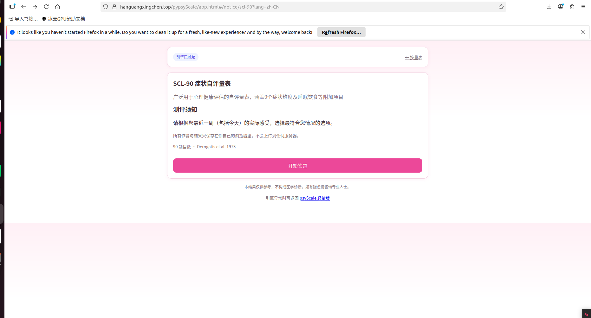

# 反思：答题卡与页面视觉对齐 psyScale（2026-11-06）

## 背景

用户反馈本版的答题卡「做得不是很好」，且页面背景「有点割裂」，要求参考网页版
psyScale（https://hanguangxingchen.top/psyScale/）的样式对齐。

## 做了什么

1. 答题卡从「题目下方内联的题号格网」改为 psyScale 的「桌面端右侧固定可折叠面板」：
   - 默认收起、只露 `▶` 箭头按钮，展开后为「答题卡」标题 + 10 列题号网格 + 已答/当前/未答图例；
   - 移动端（≤480px）整面板隐藏，保留上一题/下一题导航；
   - 可点范围保留本仓库自身要求：已作答题可回看，当前题后一题可前进，更远未作答题不可跳。

2. `body` 背景从 `linear-gradient(180deg, pink-50, #fff 42%)`（顶部粉到底部纯白的截断）
   改为 psyScale 的 `linear-gradient(135deg, pink-50 0%, #fff 50%, pink-50 100%)`
   （`min-height: 100vh`），消除页面整体的「割裂」感。

## 反思：只学样式，不搬功能

1. **对齐边界是「视觉样式」**：折叠面板布局、题号网格、图例、背景渐变。交互与判定逻辑仍以
   pypsyScale 自身设计为准（如「后点一题」就是保留的本仓库需求，而不是照抄 psyScale 的「仅已答可点」）。
2. **不搬运无关功能**：用户明确提醒「只是学样式，不要搬运那个 flag」——即 psyScale 的
   GitHub star、阳性预警 flag 等非样式元素一律不带入本仓库。
3. **视觉参照要读原站源码而非凭印象**：psyScale 是 JS 渲染的单页应用，首页静态 HTML 只有加载
   占位；需要抓 `scale.html`、`scale-runner.js` 与 `css/style.css`，从真实 DOM 结构与 CSS 类
   还原样式，而不是靠想象重构。

## 截图（对齐前）

对齐前的须知页（SCL-90），背景即当时「顶部粉到底部纯白截断」的旧样式，也是用户感到「割裂」的状态：

